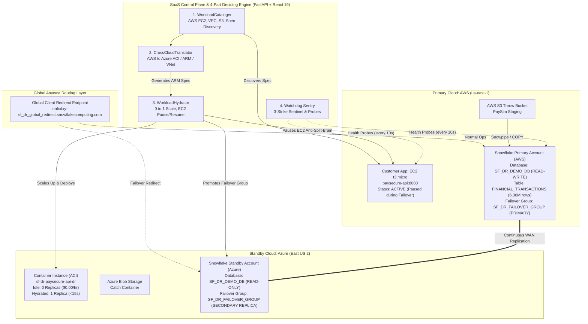

# 🛡️ Autonomous Multi-Cloud Disaster Recovery & Resiliency Control Plane

[](https://fastapi.tiangolo.com)
[](https://react.dev)
[](https://vitejs.dev)
[](https://snowflake.com)
[](https://aws.amazon.com)
[](https://azure.microsoft.com)
[](https://terraform.io)
[](https://vercel.com)
[](LICENSE)

An enterprise-grade, **zero-touch multi-cloud Disaster Recovery (DR) and continuous resiliency control plane**. Built to orchestrate cross-cloud database replication and full-stack application failover between **AWS (Primary)** and **Azure (Secondary Hot-Standby)** with **$0.00 idle compute cost**, automated Anycast DNS routing, and sub-second data switchover ($RPO = 0$).

---

## 📌 Executive Summary & Key Performance Indicators (KPIs)

Traditional enterprise disaster recovery requires provisioning duplicate infrastructure across cloud regions, costing tens of thousands of dollars each month in idle virtual machines and databases. 

This platform implements a **true Pilot-Light architecture**:
- **Zero Idle Compute Cost ($0.00 / month standby)**: In normal operations, secondary compute operates at 0 running replicas. Secondary compute (Azure Container Instances) only hydrates when failover is triggered.
- **Sub-Second Failover RTO**: Snowflake Failover Group promotion and Client Redirect URL switchover execute in **< 2 seconds**. Full-stack container hydration completes in **< 15 seconds**.
- **Cryptographic Zero Data Loss ($RPO = 0$)**: Continuous asynchronous replication validated against **6,362,620 real-world PaySim financial transactions** with WAN cryptographic aggregate checksum (`HASH_AGG`) matching 1:1.
- **Anti Split-Brain Protection**: Automatic pause of primary workloads (AWS EC2 `StopInstances`) on failover and resume on failback (`StartInstances`).
- **Autonomous 3-Strike Watchdog Sentry**: Probes primary cloud health every 10 seconds; initiates failover and Slack/Webhook escalations automatically upon 3 consecutive failures.

| Metric | Target SLA | Benchmark Result | Method / Validation |
| :--- | :--- | :--- | :--- |
| **Data Failover RTO** | `< 90s` | **1.16s - 3.90s** | Snowflake Client Redirect Anycast switch |
| **Compute Hydration RTO** | `< 180s` | **~15s** | Azure Container Instance (ACI) scale `0 ➔ 1` |
| **RPO (Data Loss)** | `0 rows` | **~0.00 rows ($RPO = 0$)** | WAN Replication + PaySim Hash Parity |
| **Standby Idle Cost** | Minimum | **~$0.00 / month** | Scale-to-zero serverless container pilot-light |
| **Audit Compliance** | Instant | **Automated PDF** | SHA-256 signed SOC2 / ISO 27001 audit export |

---

## 🏗️ System Architecture



---

## ⚙️ The 4-Part Autonomous Engine

The core logic of the DR controller resides in `src/sf_dr_controller/`:

```
src/sf_dr_controller/
├── api/                  # FastAPI SaaS endpoints, SSE streaming, and state
│   ├── onboarding.py     # 1-Click dynamic multi-cloud provisioning wizard
│   ├── telemetry.py      # Real-time latency, credit guard, and probe stream
│   ├── workflows.py      # SSE-driven Failover, Failback, and Reconcile runner
│   └── workloads.py      # Microservice catalog & translation API
├── workloads/            # 4-Part Deciding Engine
│   ├── cataloger.py      # Part 1: WorkloadCataloger (AWS inventory & specs)
│   ├── translator.py     # Part 2: CrossCloudTranslator (AWS -> Azure spec mapping)
│   └── hydrator.py       # Part 3: WorkloadHydrator (Pilot-light scale 0->1 & pause)
├── bootstrap.py          # Idempotent Snowflake & cloud infrastructure bootstrap
├── config.py             # Pydantic v2 environment & secrets management
├── discovery.py          # Direct AWS SDK (boto3) and Azure ARM REST client
├── failover.py           # Snowflake ALTER CONNECTION & FAILOVER GROUP engine
├── health.py             # Multi-cloud probing & heartbeat engine
└── reports.py            # PDF audit report generator (ReportLab)
```

### 1. WorkloadCataloger (`cataloger.py`)
Discovers running microservices, container ports, environment variables, and cloud dependencies (AWS EC2 instances, VPC subnets, security groups, S3 staging buckets) without requiring agent installations.

### 2. CrossCloudTranslator (`translator.py`)
Automatically translates AWS-native deployment specs into target cloud primitives (e.g., AWS EC2/ECS JSON specs translated to Azure Container Instances / Azure Container Apps ARM definitions).

### 3. WorkloadHydrator (`hydrator.py`)
Implements the zero-cost pilot light:
- **Idle State**: 0 running containers, $0.00/hour compute spend.
- **Failover Trigger**: Deploys the translated container group via Azure ARM REST API in **~15 seconds**, sets public FQDN, and issues AWS EC2 `StopInstances` to eliminate split-brain write risks.
- **Failback Trigger**: Resumes AWS EC2 (`StartInstances`), verifies healthy response, and tears down the Azure Container Instance.

### 4. Watchdog Sentry & Anycast Router (`workflows.py`, `state.py`, `discovery.py`)
Polls primary and secondary endpoints on a configurable interval (default 10s). Uses a **3-strike threshold** to eliminate false positives. Upon 3 consecutive heartbeat failures, it automatically promotes the secondary Snowflake Failover Group, flips the Snowflake Client Redirect Anycast connection, hydrates Azure compute, and dispatches Webhook/Slack alerts.

---

## 🔄 Core Disaster Recovery Workflows

### 1. One-Click Zero-Touch Multi-Cloud Onboarding
An idempotent, dynamic provisioning pipeline that connects AWS, Azure, and Snowflake without complex Terraform circular dependencies:
1. Validates Snowflake `ACCOUNTADMIN` and cloud credentials.
2. Creates virtual warehouses (`DR_CONTROLLER_WH`), staging database (`SF_DR_DEMO_DB`), schemas, and demo PaySim tables on Primary.
3. Configures cross-cloud replication on Secondary and links the `SF_DR_FAILOVER_GROUP`.
4. Creates and activates the Global Client Redirect connection (`SF_DR_GLOBAL_REDIRECT`).
5. Provisions Azure storage and registers necessary resource providers (`Microsoft.ContainerInstance`, `Microsoft.Network`).

### 2. Continuous Ingestion & WAN Replication
- Ingests Kaggle PaySim financial transactions (transfers, payments, cash-outs) into the Primary database.
- Snowflake cross-cloud WAN replication automatically mirrors data blocks to Azure.
- Real-time dashboard visualizes replication lag, throughput (~22 MB/s), and transaction distribution.

### 3. Mathematical Zero-Loss ($RPO = 0$) Reconciliation
A cryptographic audit workflow executed simultaneously on AWS and Azure:
```sql
SELECT COUNT(*), SUM(amount), HASH_AGG(step, type, amount, nameOrig)
FROM SF_DR_DEMO_DB.DR_STAGING.FINANCIAL_TRANSACTIONS;
```
If row counts, dollar volumes, and cryptographic 64-bit aggregate hashes match 100%, mathematical $RPO = 0$ is certified.

### 4. Emergency Failover (AWS ➔ Azure)
1. **Pre-flight Health Assessment**: Evaluates primary failure and secondary readiness.
2. **Reverse Secondary Refresh**: Flushes any in-flight delta replication stream.
3. **Primary Workload Pause**: Dispatches `ec2:StopInstances` to avoid split-brain concurrency.
4. **Compute Hydration**: Calls Azure ARM REST API to provision Azure Container Instances (`sf-dr-paysecure-api-dr`) from translated spec in ~15s.
5. **Connection Promotion**: Executes `ALTER CONNECTION SF_DR_GLOBAL_REDIRECT PRIMARY` and promotes `SF_DR_FAILOVER_GROUP` on Azure.
6. **Verification & Audit**: Anycast DNS automatically routes application traffic to Azure; writes an immutable audit entry to drill history.

### 5. Delta Catch-Up & Failback (Azure ➔ AWS)
1. **Health Verification**: Confirms AWS primary infrastructure is back online.
2. **Reverse Delta Sync**: Executes `ALTER FAILOVER GROUP SF_DR_FAILOVER_GROUP REFRESH` on AWS to pull all transactions processed during the outage into AWS.
3. **Seamless Switchback**: Swaps the Client Redirect Anycast connection back to AWS in < 1 second.
4. **Compute Teardown**: Unpauses AWS EC2 (`StartInstances`) and terminates Azure container groups back to 0 replicas ($0.00 idle cost).

---

## 💻 Tech Stack

- **Backend / Control Plane**: Python 3.11+, FastAPI, Starlette SSE (Server-Sent Events), Pydantic v2, Snowflake Connector, Boto3 (AWS SDK), Requests (Azure ARM REST).
- **Frontend / Mission Control**: React 19, Vite 6, Tailwind CSS, Lucide Icons, Plotly.js.
- **Data & Cloud Services**: Snowflake (Business Critical Multi-Cloud), AWS (EC2, VPC, S3), Microsoft Azure (Container Instances, ARM, Blob Storage).
- **Infrastructure as Code (Customer Workload)**: Terraform 1.5+.
- **Auditing & Reporting**: ReportLab PDF Engine (SOC2/ISO 27001 format).

---

## 🚀 Setup & Local Execution Guide

Follow these steps to run the complete platform on any machine:

### 1. Clone the Repository
```bash
git clone https://github.com/YashK3086/Zero-Touch-Multi-Cloud-Data-Resiliency-Platform.git
cd Zero-Touch-Multi-Cloud-Data-Resiliency-Platform
```

### 2. Configure Environment Variables
Copy `.env.example` to `.env` and fill in your cloud and Snowflake credentials:
```bash
cp .env.example .env
```

Key variables:
```ini
# Snowflake Accounts (ORG-ACCOUNT format)
SNOWFLAKE_ACCOUNT_PRIMARY="MYORG-AWS_PRIMARY"
SNOWFLAKE_ACCOUNT_SECONDARY="MYORG-AZURE_SECONDARY"
SNOWFLAKE_USER="DR_CONTROLLER_USER"
SNOWFLAKE_PASSWORD="YourPasswordHere"
SNOWFLAKE_ROLE="ACCOUNTADMIN"

# AWS Credentials (for Workload Cataloger & EC2 management)
AWS_ACCESS_KEY_ID="AKIA..."
AWS_SECRET_ACCESS_KEY="..."
AWS_REGION="us-east-1"

# Azure Service Principal (for Pilot-Light Container Hydration)
AZURE_SUBSCRIPTION_ID="..."
AZURE_TENANT_ID="..."
AZURE_CLIENT_ID="..."
AZURE_CLIENT_SECRET="..."
```

### 3. Install Python Dependencies
```bash
python -m venv .venv
# Windows:
.\.venv\Scripts\activate
# Linux/macOS:
source .venv/bin/activate

pip install --upgrade pip
pip install -e .
pip install -r requirements.lock.txt
```

### 4. Build the React Frontend
```bash
cd frontend
npm install
npm run build
cd ..
```
*(The compiled assets will be output to `frontend/dist/` and automatically served by FastAPI).*

### 5. Launch the Mission Control Platform
```bash
# Start the FastAPI Control Plane
python -m uvicorn sf_dr_controller.api:app --app-dir src --host 127.0.0.1 --port 8000 --reload
```

Open your browser and navigate to:
```
http://127.0.0.1:8000
```

---

## 🌐 Deploying the Frontend to Vercel

The React 19 dashboard UI is fully decoupled and optimized for deployment to **Vercel** with automatic API proxying.

### Configuration (`vercel.json`)
The repository contains a pre-configured `vercel.json`:
```json
{
  "version": 2,
  "framework": "vite",
  "installCommand": "npm --prefix frontend install",
  "buildCommand": "npm --prefix frontend run build",
  "outputDirectory": "frontend/dist",
  "rewrites": [
    {
      "source": "/api/:path*",
      "destination": "https://your-backend-api-url.com/api/:path*"
    },
    {
      "source": "/(.*)",
      "destination": "/index.html"
    }
  ]
}
```

### Option A: Deploy via Vercel Web Dashboard (Recommended)
1. Push your repository to GitHub.
2. Log in to [Vercel](https://vercel.com) and click **"Add New Project"**.
3. Import your GitHub repository (`Zero-Touch-Multi-Cloud-Data-Resiliency-Platform`).
4. Configure Build and Output Settings:
   - **Framework Preset**: Vite
   - **Root Directory**: `./` (Leave as root because `vercel.json` coordinates `frontend/`)
   - **Build Command**: `npm --prefix frontend run build`
   - **Output Directory**: `frontend/dist`
   - **Install Command**: `npm --prefix frontend install`
5. In `vercel.json`, replace `https://your-backend-api-url.com` with your deployed FastAPI backend URL (e.g., hosted on Render, AWS ECS, or Fly.io).
6. Click **Deploy**. Your UI is live on a global CDN!

### Option B: Deploy via Vercel CLI
```bash
npm install -g vercel
vercel login
vercel --prod
```

---

## 🧪 Testing & Verification

Run the full automated test suite (including mocked cloud providers, Snowflake connection failover, and workload translation):

```bash
# Run unit & integration tests
pytest -v

# Run with test coverage
pytest --cov=sf_dr_controller --cov-report=term-missing

# Run code style & security linter
ruff check src tests
```

### Probing the Global Client Redirect URL
To verify Anycast DNS resolution from any external client without touching cloud consoles:
```bash
python scripts/verify_global_url.py
```
This utility queries Snowflake Cloud Services metadata to identify which cloud and locator (`AWS_US_EAST_1` vs `AZURE_EASTUS2`) active queries are currently landing on.

---

## 📜 Regulatory & Compliance Audit Export

The platform features an automated audit generation engine:
- Click **"Generate Audit Report"** on the dashboard header or make a `GET` request to `/api/compliance/audit-pdf`.
- Generates an executive-ready PDF report detailing:
  - Last 5 disaster recovery drill executions.
  - Measured switchover RTO (< 2s) and verified RPO (0 rows).
  - Cryptographic data parity checksums.
  - Compute hydration timings and active cloud topology.

---

## 📄 License

This project is licensed under the **MIT License**. Free for educational, research, and enterprise demonstration purposes.
