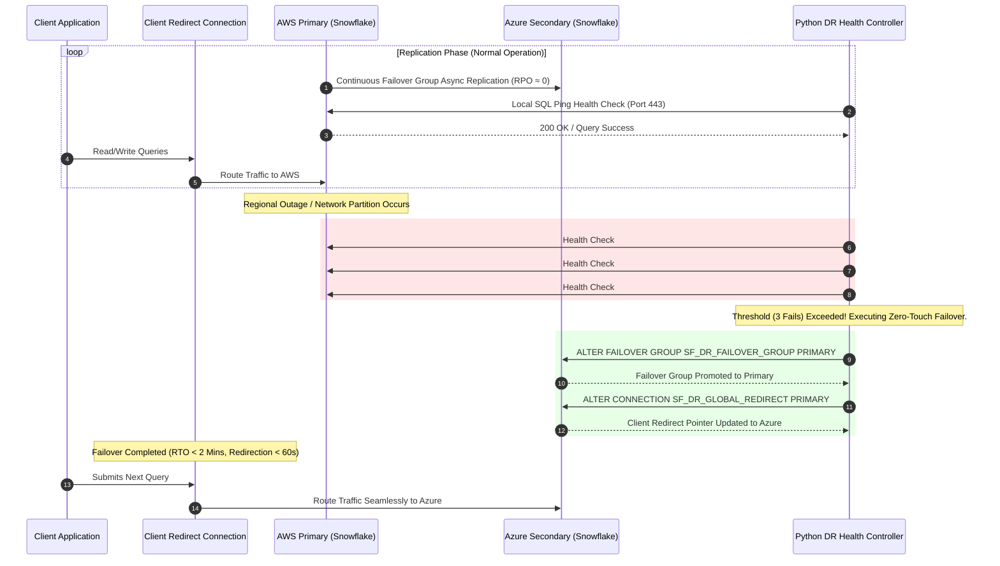

# Multi-Cloud Snowflake Disaster Recovery Architecture Blueprint

## Executive Overview
This document outlines the architecture for an automated, zero-touch disaster recovery (DR) platform spanning two major cloud providers (**AWS** and **Azure**) using **Snowflake Failover Groups** and **Snowflake Client Redirect URLs**.

---

## 1. High-Level Architecture Diagram

```
+-----------------------------------------------------------------------------------+
|                               GLOBAL CLIENT ACCESS                                |
|                                                                                   |
|         Client Application / Query Traffic (e.g. BI Tools, ETL pipelines)          |
|                                         |                                         |
|                                         v                                         |
|                 Snowflake Client Redirect Connection URL                          |
|                     (sf_dr_global_redirect.snowflakecomputing.com)                |
+-----------------------------------------------------------------------------------+
                                          |
                        +-----------------+-----------------+
                        | (Active Route)                    | (Standby Route)
                        v                                   v
        +-------------------------------+   +-------------------------------+
        |    AWS REGION (PRIMARY)       |   |   AZURE REGION (SECONDARY)    |
        |  Account: SF_AWS_PRIMARY      |   |  Account: SF_AZURE_SECONDARY  |
        |                               |   |                               |
        |  +-------------------------+  |   |  +-------------------------+  |
        |  | Primary Failover Group  |==== (Replication Stream) ===========>|
        |  |  - DB: SF_DR_DEMO_DB    |  |   |  | Secondary Read Replica  |  |
        |  |  - Users & RBAC Roles   |  |   |  |  - DB: SF_DR_DEMO_DB    |  |
        |  |  - Warehouses (X-Small) |  |   |  |  - Users & RBAC Roles   |  |
        |  +-------------------------+  |   |  +-------------------------+  |
        |               ^               |   |               ^               |
        |  +------------+------------+  |   |  +------------+------------+  |
        |  | AWS S3 Stage (Free Tier)|  |   |  | Azure Blob Storage Stage|  |
        |  +-------------------------+  |   |  +-------------------------+  |
        +-------------------------------+   +-------------------------------+
                        ^                                   ^
                        |                                   |
    +-------------------------------------------------------------------+
    |                 PYTHON AUTOMATED HEALTH CONTROLLER                |
    |                 (sf_dr_controller.py / Async Probes)              |
    |                                                                   |
    |  - Pings Primary Account every N seconds                          |
    |  - Tracks failure threshold (3 consecutive failures)              |
    |  - Triggers Zero-Touch Failover:                                  |
    |    1. ALTER FAILOVER GROUP SF_DR_FAILOVER_GROUP PRIMARY           |
    |    2. ALTER CONNECTION SF_DR_GLOBAL_REDIRECT PRIMARY              |
    +-------------------------------------------------------------------+
```

---

## 2. Dynamic Failover Sequence Diagram



---

## 3. SLA Metrics & Target Guarantees
- **RTO (Recovery Time Objective)**: Target < 120 seconds.
- **RPO (Recovery Point Objective)**: Target ≈ 0 (Replication interval set to lowest feasible schedule within Snowflake).
- **DNS/Connection Switchover Time**: < 60 seconds (managed natively by Snowflake Global Client Redirect without external BGP or DNS TTL delay).
